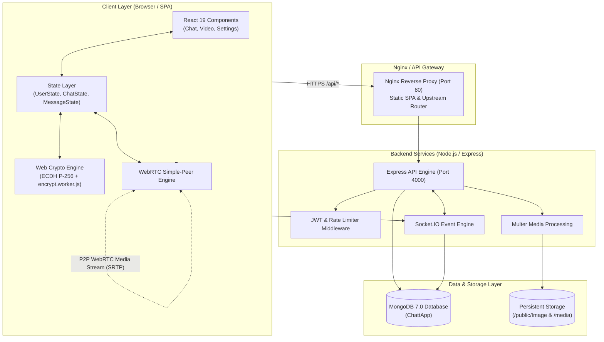
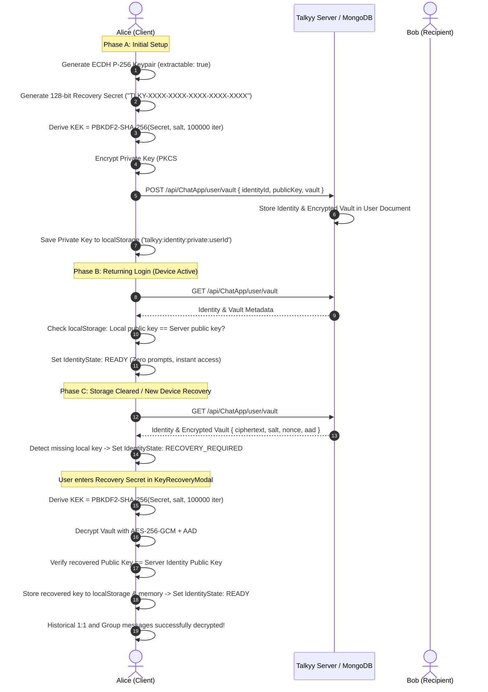
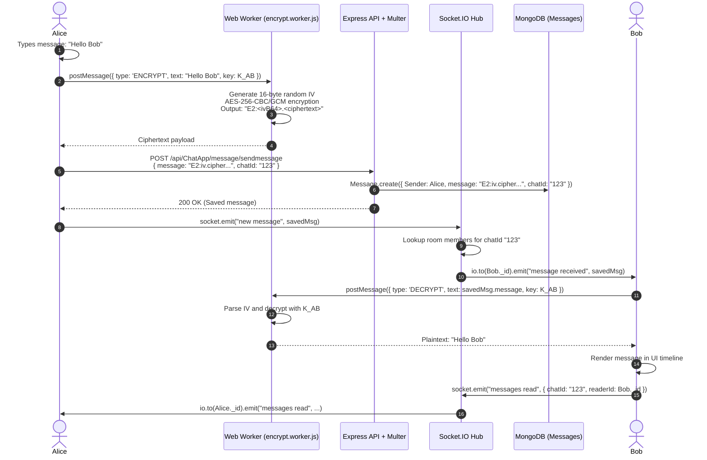
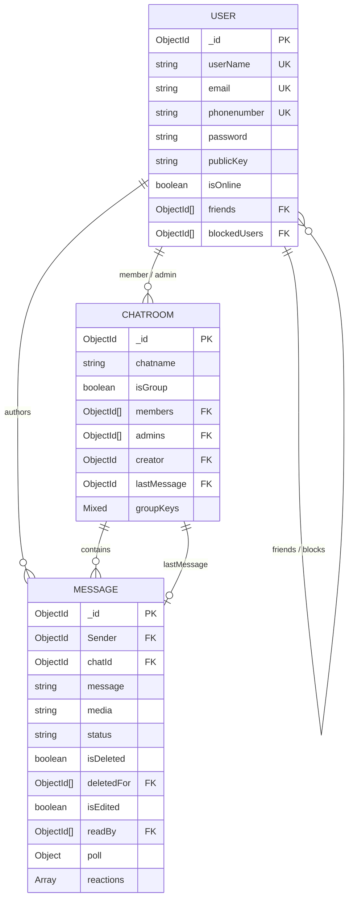
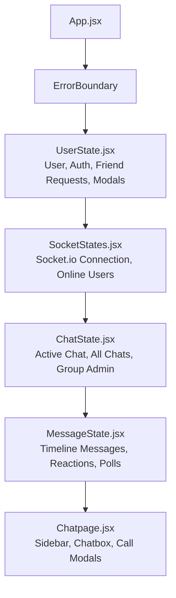

# 🌐 Talkyy: Enterprise-Grade Architecture, Security & System Design

> **Talkyy** is a high-performance, real-time communication platform built on the MERN stack with **Socket.IO**, **WebRTC peer-to-peer/mesh calling**, and **client-side End-to-End Encryption (E2EE)** utilizing **ECDH P-256** and **AES-GCM / AES-256**.

---

## 📑 Table of Contents
1. [Executive Summary & High-Level Architecture](#1-executive-summary--high-level-architecture)
2. [End-to-End System Architecture Diagram](#2-end-to-end-system-architecture-diagram)
3. [Project Flow & Core Workflows](#3-project-flow--core-workflows)
   - [3.1 Authentication & Registration Pipeline](#31-authentication--registration-pipeline)
   - [3.2 Key Generation, Zero-Knowledge Vault & Recovery Lifecycle](#32-key-generation-zero-knowledge-vault--recovery-lifecycle)
   - [3.3 Real-Time Message Flow & Cryptographic Pipeline](#33-real-time-message-flow--cryptographic-pipeline)
   - [3.4 WebRTC 1:1 and Group Call Signaling](#34-webrtc-11-and-group-call-signaling)
4. [Security Architecture & Cryptography Deep Dive](#4-security-architecture--cryptography-deep-dive)
   - [4.1 Asymmetric Identity Keys (ECDH P-256)](#41-asymmetric-identity-keys-ecdh-p-256)
   - [4.2 1:1 Chat Key Derivation (HKDF-Lite)](#42-11-chat-key-derivation-hkdf-lite)
   - [4.3 Multi-Party Group Encryption & Key Wrapping](#43-multi-party-group-encryption--key-wrapping)
   - [4.4 Web Worker Off-Thread Cryptographic Engine](#44-web-worker-off-thread-cryptographic-engine)
   - [4.5 Backend Security, Rate Limiting & Zero-Knowledge Storage](#45-backend-security-rate-limiting--zero-knowledge-storage)
   - [4.6 Zero-Knowledge Encrypted Key Vault & Identity Continuity](#46-zero-knowledge-encrypted-key-vault--identity-continuity)
5. [Database Architecture & Data Models](#5-database-architecture--data-models)
   - [5.1 User Schema](#51-user-schema)
   - [5.2 ChatRoom Schema](#52-chatroom-schema)
   - [5.3 Message Schema](#53-message-schema)
   - [5.4 Entity Relationship (ER) Diagram](#54-entity-relationship-er-diagram)
6. [Real-Time Services & WebSocket Registry](#6-real-time-services--websocket-registry)
   - [6.1 Socket Room Architecture](#61-socket-room-architecture)
   - [6.2 Complete Socket.IO Event Dictionary](#62-complete-socketio-event-dictionary)
   - [6.3 Presence & Typing Isolation](#63-presence--typing-isolation)
7. [REST API Directory](#7-rest-api-directory)
8. [Frontend State Management & Design System](#8-frontend-state-management--design-system)
   - [8.1 Context State Hierarchy](#81-context-state-hierarchy)
   - [8.2 Dual Aesthetic Design System](#82-dual-aesthetic-design-system)
9. [Deployment & Container Architecture](#9-deployment--container-architecture)
10. [Environment Variables & Setup Guide](#10-environment-variables--setup-guide)

---

## 1. Executive Summary & High-Level Architecture

Talkyy is engineered for privacy-conscious users and high-throughput real-time collaboration. It combines low-latency WebSockets with zero-knowledge cryptographic guarantees:
- **Client (Frontend)**: React 19 SPA running on Vite, Tailwind CSS v4, DaisyUI, Web Crypto API, Framer Motion, and Simple-Peer.
- **Application Server (Backend)**: Node.js + Express REST API providing authentication, session handling, user relations, group management, and static media delivery via Multer.
- **Real-Time Gateway**: Socket.IO server clustered for event broadcasting, typing indicators, read receipts, reaction relays, and WebRTC signaling.
- **Persistence Layer**: MongoDB 7.0 database storing user identities, relational graph (friends, blocked users), chatroom topologies, and encrypted message payloads.

```
┌────────────────────────────────────────────────────────────────────────┐
│                          TALKYY CLIENT (BROWSER)                       │
│  React 19 · Vite · Web Crypto (ECDH P-256) · Web Workers · Simple-Peer  │
└──────────────────┬─────────────────────────────────┬───────────────────┘
                   │ HTTPS / REST (Port 4000/4001)   │ WSS / Socket.IO
                   ▼                                 ▼
┌────────────────────────────────────────────────────────────────────────┐
│                          BACKEND GATEWAY                               │
│  Express 4 · Auth Middleware · Multer Storage · Socket.IO Signaling    │
└──────────────────┬─────────────────────────────────┬───────────────────┘
                   │ Mongoose Driver                 │ Local Volume Mount
                   ▼                                 ▼
┌──────────────────────────────────────┐  ┌──────────────────────────────┐
│         MONGODB 7.0 CLUSTER          │  │     PERSISTENT STORAGE       │
│  Users · ChatRooms · Messages        │  │  /public/Image  ·  /media    │
└──────────────────────────────────────┘  └──────────────────────────────┘
```

---

## 2. End-to-End System Architecture Diagram



---

## 3. Project Flow & Core Workflows

### 3.1 Authentication & Registration Pipeline
1. **Registration (`POST /api/ChatApp/user/register`)**:
   - The user inputs `name`, `gender`, `userName`, `phonenumber`, `email`, and `password`.
   - The request is validated with `express-validator` and protected by `authLimiter` (max 20 attempts/min).
   - The backend checks for email, phone, and username collisions in MongoDB.
   - The password is salted and hashed using **Bcrypt with 12 salt rounds**.
   - An avatar is assigned (or uploaded) and the user document is saved.
2. **Login (`POST /api/ChatApp/user/login`)**:
   - The user submits either `email` or `phonenumber` alongside `password`.
   - `User.findOne({ email })` retrieves the user record.
   - `bcrypt.compare()` verifies the candidate password.
   - `user.generateAuthToken()` signs a JWT containing the user `_id` with an expiry (`1d` or `7d`).
   - The token is set in an `httpOnly`, `sameSite: "lax"` cookie and returned in the JSON payload for clients using header authentication (`Authorization: <token>`).
3. **Session Persistence & Redirection**:
   - The frontend stores the token and `userInfo` in `localStorage`.
   - The `LandingRoute` and `Loginpage` check `localStorage.getItem('token')`. If present, visitors are redirected to `/chat`.
   - Route guard `ProtectedRoute` intercepts unauthorized visits and bounces unauthenticated users back to `/login`.

---

### 3.2 Key Generation, Zero-Knowledge Vault & Recovery Lifecycle

Talkyy uses client-side asymmetric cryptography combined with a **Zero-Knowledge Encrypted Key Vault** so that **no plaintext private key or recovery secret is ever transmitted to or stored on the server**, while ensuring users can recover their cryptographic identity across storage wipes and devices.



---

### 3.3 Real-Time Message Flow & Cryptographic Pipeline



---

### 3.4 WebRTC 1:1 and Group Call Signaling

Talkyy implements direct browser-to-browser media streaming using `simple-peer` over WebRTC, using Socket.IO purely as the signaling plane for SDP and ICE exchange:

```mermaid
sequenceDiagram
    autonumber
    actor Caller as Caller
    participant Socket as Socket.IO Signaling Server
    actor Callee as Callee

    Caller->>Caller: Requests getUserMedia(audio, video)<br/>Initializes Simple-Peer (initiator: true)
    Caller->>Socket: socket.emit("callUser", { userToCall: Callee._id, from: Caller._id, signalData, callType })
    Socket->>Callee: io.to(Callee._id).emit("callUser", { signal, from, name, callType })
    
    Note over Callee: IncomingCallModal pops up with ringtone
    Callee->>Callee: User clicks "Accept"<br/>Initializes Simple-Peer (initiator: false)
    Callee->>Socket: socket.emit("answerCall", { to: Caller._id, signal })
    Socket->>Caller: io.to(Caller._id).emit("callAccepted", signal)
    
    Note over Caller,Callee: Peer-to-Peer Media Pipe Established (SRTP)
    Caller<-.->Callee: Direct Video / Audio Stream (No server bandwidth used)

    Note over Caller,Callee: Call Termination
    Caller->>Socket: socket.emit("endCall", { to: Callee._id })
    Socket->>Callee: io.to(Callee._id).emit("callEnded")
    Caller->>Caller: Generates [CALL_LOG] encrypted message in chat timeline
```

---

## 4. Security Architecture & Cryptography Deep Dive

### 4.1 Asymmetric Identity Keys (ECDH P-256)
- **Algorithm**: Elliptic Curve Diffie-Hellman over NIST P-256 curve (`ECDH`).
- **Generation**: Triggered client-side via `window.crypto.subtle.generateKey()`:
  ```javascript
  const keyPair = await window.crypto.subtle.generateKey(
    { name: "ECDH", namedCurve: "P-256" },
    true, // extractable
    ["deriveKey", "deriveBits"]
  );
  ```
- **Storage**:
  - **Local Runtime Key**: Exported as PKCS#8 and stored in the client's `localStorage` (`talkyy:identity:private:<userId>`) for active session performance.
  - **Encrypted Remote Vault**: When created, the private key is encrypted client-side using **AES-256-GCM** with a key derived from the user's secret recovery key via **PBKDF2-HMAC-SHA-256 (100,000 iterations)**. The resulting ciphertext is stored in MongoDB inside `user.identity.vault`. The plaintext private key never touches the network or server.
  - **Public Key**: Exported as raw SPKI, base64 encoded, and synchronized to the server via `POST /api/ChatApp/user/vault` or guarded `PUT /api/ChatApp/user/publickey`.

### 4.2 1:1 Chat Key Derivation (HKDF-Lite)
When Alice and Bob enter a 1:1 chatroom:
1. Alice uses her local private key and Bob's public key from the chatroom member document.
2. `window.crypto.subtle.deriveBits()` computes the raw 256-bit shared point $S = \text{ECDH}(\text{Priv}_A, \text{Pub}_B)$.
3. The shared point is passed through a key derivation function with a context salt:
   $$\text{Key}_{AB} = \text{SHA-256}(S \mathbin{\Vert} \text{"talkyy-chat:"} \mathbin{\Vert} \text{chatId})$$
4. Because $\text{ECDH}(\text{Priv}_A, \text{Pub}_B) == \text{ECDH}(\text{Priv}_B, \text{Pub}_A)$, both clients independently arrive at the exact same 256-bit symmetric encryption key without exchanging any secret over the network.

### 4.3 Multi-Party Group Encryption & Key Wrapping
In group chats with $N$ members, pairwise derivation alone is insufficient because messages must be sent to the group at once. Talkyy solves this with **Key Wrapping**:
1. **Group Key Generation**: The group creator (or key rotator) generates a cryptographically random 256-bit Group Key ($GK$).
2. **Key Wrapping**: For each active member $M_i$ in the group:
   - Compute pairwise wrapping key $W_i = \text{ECDH}(\text{Priv}_{\text{sender}}, \text{Pub}_{M_i})$.
   - Encrypt $GK$ using AES-GCM with a fresh 12-byte IV:
     $$C_i = \text{AES-GCM-Encrypt}(W_i, GK)$$
   - Store wrapped keys in the chatroom document under `groupKeys[memberId]`:
     ```json
     {
       "by": "creator_id",
       "byKey": "creator_public_key",
       "key": "<iv_base64>.<ciphertext_base64>"
     }
     ```
3. **Decryption by Member**: Any member reads their own slice `groupKeys[myUserId]`, computes $W_i$ using their private key and `byKey`, unwraps $GK$, and caches it in memory.
4. **Forward Secrecy on Membership Changes**: When a member leaves or is removed via `/api/ChatApp/Chat/removefromGroup`, the group key is regenerated and re-wrapped only for the remaining members, preventing former members from decrypting future messages.

### 4.4 Web Worker Off-Thread Cryptographic Engine
To ensure **60 FPS zero-lag scrolling** in active chats, CPU-heavy cryptographic operations run in a dedicated Web Worker (`src/workers/encrypt.worker.js`).
- **Worker Pipeline**:
  - The main UI thread dispatches an asynchronous task to the worker pool.
  - The worker performs AES encryption/decryption on chunks off the main thread.
  - The main UI thread receives the parsed plaintext or ciphertext without dropping frames.
  - Fallback logic executes synchronously if Web Workers are restricted by browser security policies.

### 4.5 Backend Security, Rate Limiting & Zero-Knowledge Storage
- **Zero-Knowledge Ciphertexts**: All message texts and media file metadata in the database are stored as opaque ciphertext strings prefixed with `E2:`. Database administrators, MongoDB Atlas operators, or attackers with read access to the database cannot read user communications.
- **In-Memory Rate Limiting ([rateLimiter.js](file:///d:/React%20practice/Live%20Chat%20app/backend/middleware/rateLimiter.js))**:
  - `authLimiter`: 20 requests/min per IP on login and registration.
  - `messageLimiter`: 90 messages/min per IP to prevent spam or flood attacks.
  - `vaultLimiter`: 10 requests/min per IP on vault operations to prevent brute-forcing.
  - `friendReqLimiter`: 30 requests/min per IP.
  - `groupCreateLimiter`: 15 groups/min per IP.
- **Bcrypt Hashing**: Passwords undergo 12 salt rounds before storage.
- **Password Reset Security**: Forgot password generates a 20-byte cryptographically random hex token, hashes it via SHA-256 before database storage, and enforces a strict 15-minute expiration timestamp.

### 4.6 Zero-Knowledge Encrypted Key Vault & Identity Continuity
To resolve the cryptographic identity loss problem when browser storage is wiped, Talkyy implements a Zero-Knowledge Key Vault:
1. **Recovery Secret**: A cryptographically random 128-bit secret formatted as `TLKY-XXXX-XXXX-XXXX-XXXX-XXXX` (Base32 alphabet excluding easily confused glyphs `0`, `O`, `1`, `I`).
2. **Key Derivation (PBKDF2-HMAC-SHA-256)**:
   - Salt: 32 cryptographically random bytes generated via `crypto.getRandomValues()`.
   - Iterations: 100,000 rounds.
   - Output: 256-bit Key Encryption Key (KEK).
3. **Authenticated Vault Encryption (AES-256-GCM)**:
   - Nonce: Unique 96-bit (12-byte) initialization vector per encryption.
   - Additional Authenticated Data (AAD): Authenticated JSON containing `{ identityId, purpose: "TalkyyIdentityVaultV1", version: 1 }`. Any tampering or attempt to replay ciphertext under another identity causes GCM authentication tag verification to fail immediately.
4. **Key Fingerprinting**:
   - SHA-256 digest of canonical SPKI base64 public key formatted as colon-separated hex bytes (e.g. `e3:b0:c4:42...`).
5. **Separation of Authentication & Encryption**:
   - Account login authenticates access to the user account.
   - Encryption recovery unlocks historical messages locally.
   - A password change or password reset does NOT alter the identity key or recovery vault.
   - If a device is cleared, the backend rejects silent public-key overwrites and guides the user through `KeyRecoveryModal`.


---

## 5. Database Architecture & Data Models

### 5.1 User Schema ([user.model.js](file:///d:/React%20practice/Live%20Chat%20app/backend/models/user.model.js))
| Field | Type | Attributes | Description |
| :--- | :--- | :--- | :--- |
| `name` | String | Required | Full display name |
| `gender` | String | Enum: `["male", "female"]` | Profile attribute |
| `userName` | String | Required, Unique, Indexed | Unique system handle (e.g. `@rana`) |
| `phonenumber` | String | Required, Unique, RegEx `\d{10}` | 10-digit mobile number |
| `email` | String | Required, Unique, RegEx email | Contact email |
| `password` | String | Required, min 6 chars | Bcrypt hashed string |
| `avtar` | String | Default `""` | Path to image or base64 data |
| `isOnline` | Boolean | Default `false` | Presence flag updated by socket events |
| `lastSeen` | Date | Optional | Timestamp of last socket disconnect |
| `resetPasswordToken` | String | Optional | SHA-256 hashed password reset token |
| `resetPasswordExpire`| Date | Optional | Reset token expiry timestamp |
| `friends` | ObjectId[] | Ref `User` | Confirmed friends list |
| `friendRequests` | Array | Objects `{ sender, status }` | Pending/rejected friend requests |
| `blockedUsers` | ObjectId[] | Ref `User` | List of blocked user ObjectIds |
| `publicKey` | String | Default `""` | Base64-encoded ECDH P-256 Public Key (legacy mirror) |
| `identity.identityId` | String | Indexed | Stable identity UUID |
| `identity.version` | Number | Default `1` | Identity version counter |
| `identity.publicKey` | String | Required for E2EE | Canonical Base64-encoded ECDH P-256 Public Key |
| `identity.publicKeyFingerprint` | String | Hex string | SHA-256 fingerprint of public key |
| `identity.vault.formatVersion` | Number | Default `1` | Vault envelope schema version |
| `identity.vault.cipher` | String | `AES-256-GCM` | Authenticated symmetric cipher |
| `identity.vault.kdf` | String | `PBKDF2-HMAC-SHA256` | Password-based key derivation function |
| `identity.vault.kdfIterations` | Number | Default `100000` | KDF iteration count |
| `identity.vault.salt` | String | Base64 | 32-byte cryptographically random KDF salt |
| `identity.vault.nonce` | String | Base64 | 12-byte (96-bit) AES-GCM IV |
| `identity.vault.ciphertext` | String | Base64 | Encrypted PKCS#8 private key envelope + auth tag |
| `identity.vault.aad` | String | JSON String | Additional Authenticated Data bound to user & vault |
| `identity.vault.updatedAt` | Date | Timestamp | Last update timestamp |

---

### 5.2 ChatRoom Schema ([Chatroom.model.js](file:///d:/React%20practice/Live%20Chat%20app/backend/models/Chatroom.model.js))
| Field | Type | Attributes | Description |
| :--- | :--- | :--- | :--- |
| `chatname` | String | Default `""` | Group title or empty for 1:1 chats |
| `isGroup` | Boolean | Default `false` | True if multi-party group chat |
| `members` | ObjectId[] | Ref `User`, Required | Array of participating user ObjectIds |
| `admins` | ObjectId[] | Ref `User`, Required | Group administrators with elevate/kick rights |
| `creator` | ObjectId | Ref `User` | User who created the group |
| `groupIcon` | String | Default `""` | URL/filepath to group avatar |
| `lastMessage` | ObjectId | Ref `Message` | Pointer to latest message for sidebar previews |
| `groupKeys` | Mixed | Optional | Map of wrapped group keys keyed by `memberId` |

---

### 5.3 Message Schema ([Message.model.js](file:///d:/React%20practice/Live%20Chat%20app/backend/models/Message.model.js))
| Field | Type | Attributes | Description |
| :--- | :--- | :--- | :--- |
| `Sender` | ObjectId | Ref `User`, Required | Author of the message |
| `message` | String | Optional | Encrypted message ciphertext (`E2:...`) |
| `media` | String | Default `""` | Path to uploaded attachment |
| `status` | String | Enum: `["delivered", "read"]` | Read receipt tracking |
| `isDeleted` | Boolean | Default `false` | Hard delete flag for all participants |
| `deletedAt` | Date | Default `null` | Deletion timestamp |
| `deletedFor` | ObjectId[] | Ref `User` | Soft delete list (hidden only for specific users) |
| `isEdited` | Boolean | Default `false` | True if edited within the 1-hour edit window |
| `editedAt` | Date | Default `null` | Timestamp of latest modification |
| `readBy` | ObjectId[] | Ref `User` | Array of users who viewed the message |
| `reactions` | Array | `[{ user, emoji }]` | Interactive emoji reactions |
| `poll` | Object | `{ question, options: [{ text, votes }] }` | In-chat poll subdocument with member votes |
| `chatId` | ObjectId | Ref `ChatRoom`, Required | Parent conversation ID |

---

### 5.4 Entity Relationship (ER) Diagram



---

## 6. Real-Time Services & WebSocket Registry

### 6.1 Socket Room Architecture
The Socket.IO server ([server.js](file:///d:/React%20practice/Live%20Chat%20app/backend/server.js)) implements a dual-room model:
1. **Personal User Rooms (`socket.join(userId)`)**: Each user joins a private room named after their MongoDB `_id`. This allows direct, targeted events such as incoming 1:1 calls, personal message delivery, and friend request notifications.
2. **Conversation Rooms (`socket.join(chatId)`)**: When opening a conversation, the client joins the `chatId` room to receive ephemeral signals like `typing` and `stop typing`.

---

### 6.2 Complete Socket.IO Event Dictionary

| Event Name | Direction | Payload | Description |
| :--- | :--- | :--- | :--- |
| `setup` | Client → Server | `userData` | Registers user socket, joins personal room, marks `isOnline: true` |
| `getOnlineUsers` | Server → Client | `string[]` (User IDs) | Broadcasts active online user IDs to all connected clients |
| `join chat` | Client → Server | `roomId` | Subscribes socket to conversation-level events |
| `typing` / `stop typing` | Client → Server → Client | `roomId` | Relays typing status (filters out blocked senders) |
| `new message` | Client → Server | `msgDoc` | Distributes new encrypted message to all chat participants |
| `message received` | Server → Client | `msgDoc` | Delivers incoming message to recipients |
| `messages read` | Both | `{ chatId, readerId }` | Marks messages read and synchronizes double blue ticks |
| `new reaction` / `reaction updated` | Both | `updatedMsg` | Broadcasts added/removed emoji reactions on messages |
| `poll update` | Both | `updatedMsg` | Broadcasts real-time vote tallying on interactive polls |
| `delete message` / `message deleted` | Both | `{ messageId, chatId, forEveryone }` | Broadcasts message deletion across participants |
| `edit message` / `message edited` | Both | `updatedMsg` | Broadcasts edited text within the 1-hour window |
| `request group key` | Both | `{ chatId, userId, publicKey }` | Requests wrapped group keys from online peers |
| `callUser` | Both | `{ userToCall, from, signalData, callType }` | WebRTC SDP offer signal for 1:1 audio/video call |
| `answerCall` | Both | `{ to, signal }` | WebRTC SDP answer signal accepting the call |
| `endCall` / `callEnded` | Both | `{ to }` | Terminates active WebRTC media connection |
| `startGroupCall` / `incomingGroupCall`| Both | `{ chatId, chatName, initiator, callType }` | Initializes multi-participant group video call |

---

### 6.3 Presence & Typing Isolation
- **Presence Mapping**: An in-memory Map `onlineUsers = new Map()` stores `userId → socketId`. When a socket disconnects, the server clears the mapping, updates `isOnline: false` and sets `lastSeen: new Date()` in MongoDB.
- **Bi-Directional Block Enforcement**: When receiving a `typing` event, the backend verifies whether the typist is in the recipient's `blockedUsers` list. If blocked, the typing event is discarded immediately.

---

## 7. REST API Directory

### 7.1 Authentication & Profile APIs (`/api/ChatApp/user`)
- `POST /register`: Register new user account.
- `POST /login`: Authenticate with email/phone and password.
- `POST /logout`: Clear auth token and cookie.
- `GET /getUser`: Fetch profile of the authenticated user.
- `PUT /changePassword`: Update account password.
- `PUT /image`: Upload profile avatar (Multer middleware).
- `GET /Alluser?search=`: Search users by name, username, or email.
- `POST /password/forgot`: Request password reset email.
- `PUT /password/reset/:token`: Submit new password using reset token.
- `POST /request/send`: Send a friend request.
- `GET /request/get`: Retrieve incoming friend requests.
- `POST /request/accept`: Accept a pending friend request.
- `GET /friends`: List all confirmed friends.
- `PUT /block`: Block a user by ID.
- `PUT /unblock`: Unblock a user by ID.
- `PUT /publickey`: Publish client-generated ECDH P-256 public key (guarded: rejects overwrites with 409 Conflict if key already registered).
- `GET /vault`: Fetch user's registered public identity and encrypted key vault envelope (rate-limited via `vaultLimiter`).
- `POST /vault`: Register initial zero-knowledge key vault envelope and public key identity.
- `PUT /vault`: Update or rewrap existing encrypted key vault envelope (requires matching or incremented version).
- `POST /identity/reset`: Explicitly reset identity and cryptographic keys with account password verification.

### 7.2 Conversation Management APIs (`/api/ChatApp/Chat`)
- `POST /chat`: Access or create a 1:1 conversation with another user.
- `GET /allChat`: Fetch all 1:1 and group conversations for the user.
- `POST /makeGroup`: Create a new group chat with name, members, and optional icon.
- `PUT /renameGroup`: Rename an existing group (admin only).
- `PUT /addtoGroup`: Add new members to a group.
- `PUT /removefromGroup`: Remove a member from a group (triggers key rotation).
- `PUT /makeAdmin` / `PUT /removeAdmin`: Promote or demote group administrators.
- `PUT /leaveGroup`: Leave a group chat.
- `PUT /deleteGroup`: Permanently delete group (creator only).
- `PUT /groupimage`: Update group icon.
- `PUT /groupkey`: Update wrapped group encryption keys.

### 7.3 Message Operations APIs (`/api/ChatApp/message`)
- `POST /sendmessage`: Store a new encrypted message or media upload.
- `POST /allmessages`: Fetch paginated chat history for a conversation.
- `POST /deleteMessage`: Delete message (for self or for everyone).
- `PUT /markread`: Mark all unread messages in a chatroom as read.
- `PUT /react`: Add or remove an emoji reaction on a message.
- `PUT /vote`: Cast a vote on a message poll option.
- `PUT /editMessage`: Edit message text within the 1-hour time window.

---

## 8. Frontend State Management & Design System

### 8.1 Context State Hierarchy



- **`UserState`**: Manages logged-in user profile, authentication state, token persistence, and modal toggles (`card` for profile settings, `pass` for password updates, `logoutModal` for sign-out confirmation).
- **`SocketStates`**: Handles the lifecycle of the Socket.IO connection, registers setup events, and maintains the `onlineUsers` array.
- **`ChatState`**: Houses `selectedchat`, conversation list `chat`, group administration actions, and triggers ECDH key registration via `registerChats()`.
- **`MessageState`**: Stores message history `messages`, handles optimistic updates, reaction mutations, and in-chat poll votes.

---

### 8.2 Dual Aesthetic Design System

Talkyy implements two cohesive visual aesthetics:

1. **Warm Paper Aesthetic (Public Pages)**:
   - Applied across Landing page (`/`), Login (`/login`), Register, and Legal pages.
   - **Colors**: Canvas `#F7F5EF` (Warm Paper), Primary Ink `#14171A`, Secondary Ink `#535862`, Cobalt Blue `#2858E8` CTA accents.
   - **Typography**: Display headlines in `Space Grotesk`, body copy in `DM Sans`.
   - **Elements**: Crisp rounded cards, subtle bordered containers, and micro-interactions.

2. **Aurora Night & Sky (Workspace Chat)**:
   - Applied across `/chat` and chat modaled interfaces.
   - **Dark Mode (Aurora Night)**: Canvas `#0A0E17`, Panels `#101725`, Surfaces `#171F31`, Borders `rgba(255,255,255,0.12)`.
   - **Light Mode (Sky)**: Canvas `#F3F6FC`, Panels `#FFFFFF`, Primary `#2563EB`.
   - **Typography**: `Inter` for optimal message readability and dense information display.

---

## 9. Deployment & Container Architecture

Talkyy is packaged into a production-ready, three-container stack via **Docker Compose**:

```yaml
services:
  mongodb:
    image: mongo:7.0
    container_name: talkyy-mongodb
    restart: unless-stopped
    ports:
      - "27017:27017"
    volumes:
      - mongo_data:/data/db

  backend:
    build:
      context: ./backend
      dockerfile: Dockerfile
    container_name: talkyy-backend
    restart: unless-stopped
    ports:
      - "4001:4000"
    environment:
      - PORT=4000
      - DATABASE_URI=mongodb://mongodb:27017/ChattApp
      - JWT_SECRET=jwt_secret_key
      - JWT_EXPIRATION=7d
      - CLIENT_URL=http://localhost
      - NODE_ENV=production
    volumes:
      - media_uploads:/app/public/media
      - image_uploads:/app/public/Image
    depends_on:
      mongodb:
        condition: service_healthy

  frontend:
    build:
      context: ./frontend
      dockerfile: Dockerfile
    container_name: talkyy-frontend
    restart: unless-stopped
    ports:
      - "80:80"
    depends_on:
      - backend
```

- **Frontend Container**: Multi-stage build (Node.js builds the production bundle, Nginx Alpine serves static assets and reverse-proxies `/api` and `/socket.io`).
- **Backend Container**: Node.js Alpine image running the Express & Socket.IO server.
- **MongoDB Container**: Official MongoDB 7.0 engine with persistent Docker volume `mongo_data`.
- **Media Persistence**: Separate volumes `media_uploads` and `image_uploads` retain shared files across container recreations.

---

## 10. Environment Variables & Setup Guide

### 10.1 Environment Variables Reference

#### Backend (`backend/.env`)
```env
PORT=4000
DATABASE_URI=mongodb://127.0.0.1:27017/ChattApp
JWT_SECRET=your_jwt_secret_key_here
JWT_EXPIRATION=7d
SMPT_SERVICE=gmail
SMPT_MAIL=your_email@gmail.com
SMPT_PASSWORD=your_app_specific_password
CLIENT_URL=http://localhost:5173
```

---

### 10.2 Running the Application Locally

#### 1. Start MongoDB
Ensure MongoDB is running locally on port 27017:
```bash
mongod
```

#### 2. Start the Backend Server
```bash
cd backend
npm install
npm run dev
# Backend starts on http://localhost:4000
```

#### 3. Start the Frontend Client
```bash
cd frontend
npm install
npm run dev
# Frontend dev server starts on http://localhost:5173
```

---

### 10.3 Running with Docker Compose (One-Command Production Setup)

To build and spin up the entire containerized architecture:
```bash
docker compose up -d --build
```
Access points:
- **Web Application**: `http://localhost` (Port 80)
- **Backend Direct API**: `http://localhost:4001`
- **Database Engine**: `localhost:27017`

To inspect container logs:
```bash
docker logs -f talkyy-backend
```
To shut down containers while keeping data intact:
```bash
docker compose down
```
